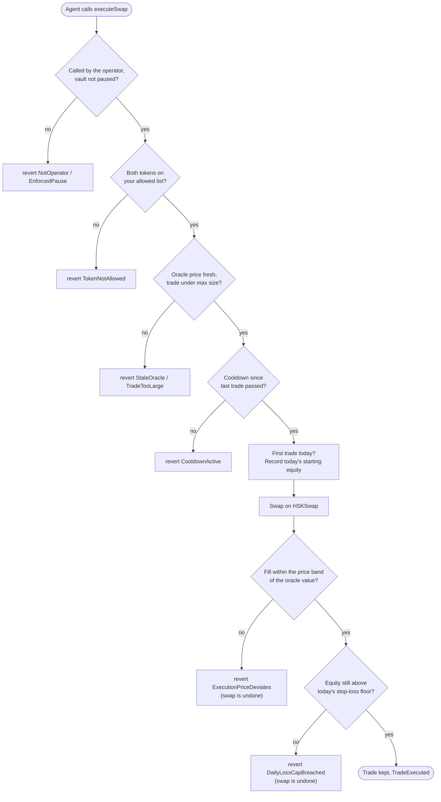
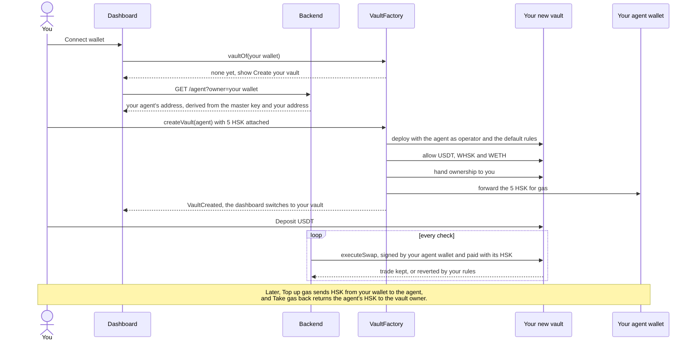
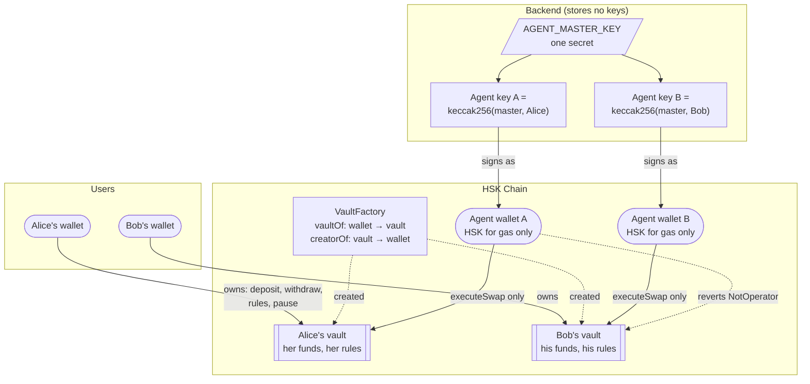
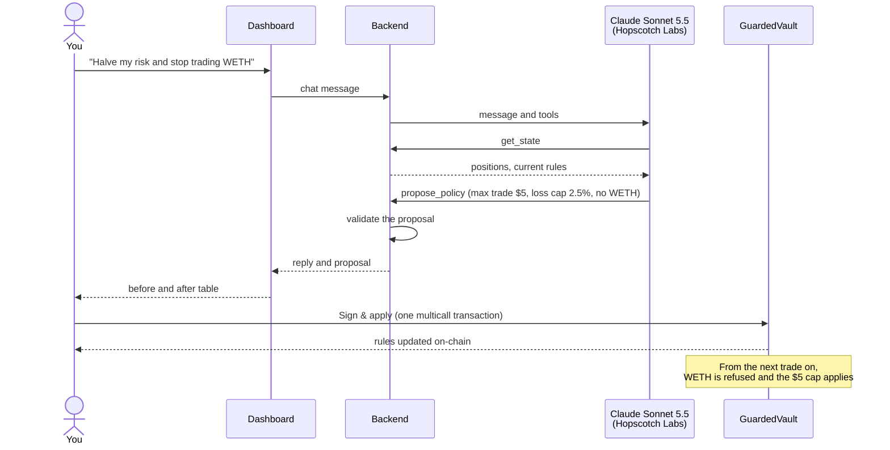
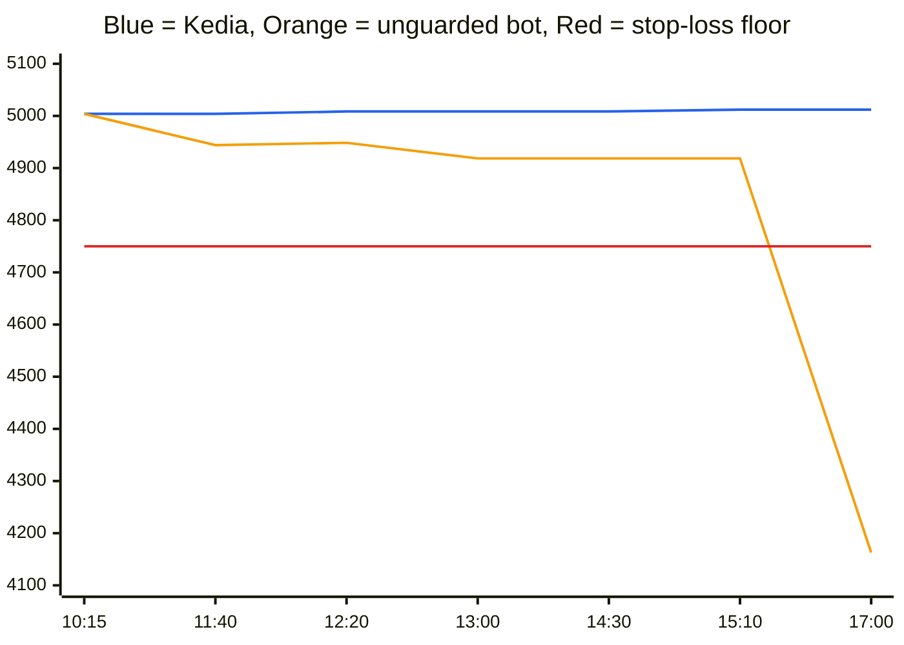

<p align="center">
  <picture>
    <source media="(prefers-color-scheme: dark)" srcset="brand/png/kedia-lockup-dark-1200w.png">
    
  </picture>
</p>

# Kedia

**An AI trading agent you can hand your money to, because it cannot break your rules.**

Kedia is an autonomous trading agent for **HSKSwap** on **HSK Chain**. Your funds sit in a vault contract that only you own. The agent gets its own wallet that can do exactly one thing: ask your vault for a swap. The vault checks every swap against limits you set, on-chain, and reverts anything that breaks them. You steer it in plain English and sign the changes that matter.

Entry for the **HSK Chain Horizon Hackathon · Mumbai, Track 1: AI Agent Trading**.

## At a glance

| | |
|---|---|
| **Problem** | Trading bots and AI agents need your wallet key. A key can do anything, and "stop at 5% loss" in a prompt is a suggestion, not a rule. |
| **Solution** | A per-user `GuardedVault` that holds the funds and enforces trade size, daily stop-loss, token allowlist, price sanity and oracle freshness in Solidity. The agent's key can only call `executeSwap`. |
| **Strategy** | Buys when HSKSwap prices a token below the HashKey Exchange order book, sells when above, with a mean-reversion or momentum signal. Default edge 0.6% after fees and price impact. |
| **Control** | Chat with Claude Sonnet 5.5: "halve my risk and stop trading WETH" becomes a before/after diff you sign in one transaction. The model never holds a key. |
| **Chain** | Live on HSK Chain testnet (id 133), as the organisers allow for the hackathon; mainnet (id 177) follows. HSKSwap SwapRouter02 + QuoterV2 (on testnet, the Uniswap V3 contracts HSKSwap forks), Supra price oracle, HashKey Exchange public API. |
| **Status** | Live at [kedia-nu.vercel.app](https://kedia-nu.vercel.app) on HSK testnet. 36 Foundry tests (31 on a fork of HSK mainnet with real HSKSwap pools, 5 for the testnet stack) plus 10 unit tests, all passing. See [Status](#status-implemented-vs-planned). |
| **Code** | [github.com/AAYUSH-GUPTA-coder/Kedia](https://github.com/AAYUSH-GUPTA-coder/Kedia). ~3,300 lines across Solidity, backend, AI and frontend, all written during the hackathon (first commit 25 Oct 2026). |
| **Demo video** | _Link added at submission._ |
| **Live dashboard** | [kedia-nu.vercel.app](https://kedia-nu.vercel.app) on HSK testnet. Visitors without a wallet see the demo vault read-only. |

## Why Kedia is different

Most agent-trading projects answer "how do I trust the agent?" in one of two ways: put the rules in the prompt, or make the human approve every trade. Kedia does neither.

- **Rules are contract code, not prompt text.** A prompt injection, a model mistake or a bug in a strategy update cannot move more than your max trade, trade a token you did not approve, or trade past your daily loss cap. The transaction reverts.
- **The agent never holds your funds.** Each vault has its own agent wallet holding only HSK for gas. That wallet can call one function on one vault. It cannot withdraw, change rules, or touch anyone else's vault. Even a leaked backend secret cannot drain a vault.
- **Autonomy and control at the same time.** You set rules once and the agent trades on its own, around the clock. You change the rules by chat and one signature, and the agent cannot undo them.
- **The last two checks run after the swap.** The price band and the stop-loss are checked on the real fill, inside the same transaction. A manipulated pool or a bad fill is undone, not just discouraged.
- **Every guardrail has a fork test against real pools.** A manipulated-pool test dumps a million WHSK into the live WHSK/USDT pool and shows `ExecutionPriceDeviates` undoing the trade. See [Verify it yourself](#verify-it-yourself).

## How Kedia meets the Track 1 brief

The track asks for an AI agent that runs the full loop on a DEX without manual intervention, captures arbitrage and price spreads, trades under strict risk control and stop-loss, and lets users view positions and P&L and adjust strategy through natural language.

| The brief asks for | Kedia | Where |
|---|---|---|
| Market monitoring and on-chain data analysis | Every 30 s the agent reads the HashKey Exchange order book, an HSKSwap QuoterV2 quote for the exact trade size, and the on-chain oracle price | `Backend/src/market.ts` |
| Signal identification | Mean-reversion on the DEX-vs-exchange gap (default), or a fast/slow EMA momentum signal | `Backend/src/strategy.ts` |
| Order execution on the DEX, no manual step | The agent wallet calls `executeSwap`, which swaps through HSKSwap SwapRouter02. Rejected trades are simulated first, so they cost no gas | `Backend/src/agent.ts`, `SmartContracts/src/GuardedVault.sol` |
| Arbitrage and price-spread capture | Trades only when HSKSwap is mispriced against the exchange by more than the edge, after fees and impact | `Backend/src/strategy.ts` |
| Strict risk control and stop-loss | Max trade size, daily loss cap, token allowlist, cooldown, oracle freshness and a fill-price band, enforced on-chain | `GuardedVault.executeSwap` |
| Natural-language view of positions and P&L | Chat tool `get_state` returns positions, equity, P&L, policy and recent decisions | `AI/src/index.ts`, `Backend/src/server.ts` |
| Adjust sizing, frequency, risk appetite and target assets by conversation | `propose_policy` (on-chain rules, you sign) and `propose_strategy` (agent settings, you confirm) | `AI/src/index.ts`, `Frontend/src/components/Chat.tsx` |
| Built on HSK Chain with recommended products | HSKSwap router and quoter, Supra oracle on HSK, HashKey Exchange API; APRO feeds evaluated (see [Where prices come from](#where-prices-come-from)) | `ABI/addresses.json` |
| Deployed on HSK Chain mainnet | Deploy script with Blockscout verification; fork of mainnet used for all tests | `SmartContracts/script/Deploy.s.sol` |

## Try it on HSK testnet

Kedia runs on **HSK Chain testnet** (chain 133) for the hackathon, as the organisers allow; mainnet comes after judging.

- **Live dashboard:** [kedia-nu.vercel.app](https://kedia-nu.vercel.app). Without a wallet you see the demo vault read-only.
- **Wallet:** connect MetaMask; the dashboard offers to add and switch to HSK Chain Testnet (RPC `https://testnet.hsk.xyz`).
- **Gas:** claim testnet HSK at the official faucet, [hskchain.net/faucet](https://hskchain.net/faucet).
- **Tokens:** press **Get test tokens** in the dashboard for 100 test USDT and 1,000 test WHSK (once an hour).
- **Explorer:** [testnet-explorer.hskchain.net](https://testnet-explorer.hskchain.net). Every trade and rejection links there.

Deployed contracts on HSK testnet (all addresses are in [`ABI/addresses.testnet.json`](ABI/addresses.testnet.json)):

| Contract | Address |
|---|---|
| VaultFactory (verified) | [`0x44C9b017010922ca7E5D03Bac6f9D3a6f47d757e`](https://testnet-explorer.hskchain.net/address/0x44C9b017010922ca7E5D03Bac6f9D3a6f47d757e) |
| Demo GuardedVault (verified) | [`0x4028E060CAc7445E5C68C6Cd0E3e87eC8f9b8006`](https://testnet-explorer.hskchain.net/address/0x4028E060CAc7445E5C68C6Cd0E3e87eC8f9b8006) |
| Test USDT (verified) | [`0x9768C04C9bC6297bB97ebc7FdE519018A693Bc86`](https://testnet-explorer.hskchain.net/address/0x9768C04C9bC6297bB97ebc7FdE519018A693Bc86) |
| Test WHSK (verified) | [`0xb8c7e1f97C2D6C1893B1fEe7D0c42A9468761908`](https://testnet-explorer.hskchain.net/address/0xb8c7e1f97C2D6C1893B1fEe7D0c42A9468761908) |
| Test WETH (verified) | [`0x1922968E9A8131FEda8bD04c1dD0312A78a0356C`](https://testnet-explorer.hskchain.net/address/0x1922968E9A8131FEda8bD04c1dD0312A78a0356C) |
| Supra price adapter, USDT (verified) | [`0x9Ba50d3dbC233DB009B003a5E4d786fF5935B6DD`](https://testnet-explorer.hskchain.net/address/0x9Ba50d3dbC233DB009B003a5E4d786fF5935B6DD) |
| Supra price adapter, WHSK (verified) | [`0x075ADF9b65a95B5a868906421EE00F58F7b1F34c`](https://testnet-explorer.hskchain.net/address/0x075ADF9b65a95B5a868906421EE00F58F7b1F34c) |
| Supra price adapter, WETH (verified) | [`0x7b4F0665712C61b093b70C3861Fbf1E02145ed1A`](https://testnet-explorer.hskchain.net/address/0x7b4F0665712C61b093b70C3861Fbf1E02145ed1A) |
| Uniswap V3 SwapRouter02 | [`0x7Ca4972B9a8b2D882c2D84c3e9217AD1753FfEE6`](https://testnet-explorer.hskchain.net/address/0x7Ca4972B9a8b2D882c2D84c3e9217AD1753FfEE6) |
| Uniswap V3 QuoterV2 | [`0x75B491DC839A13BcEc836E7E8c4305Ed4fD40F68`](https://testnet-explorer.hskchain.net/address/0x75B491DC839A13BcEc836E7E8c4305Ed4fD40F68) |
| WHSK/USDT pool (0.3%) | [`0xe65fC10110B3e6f6d252bE49F94e06De3e62718F`](https://testnet-explorer.hskchain.net/address/0xe65fC10110B3e6f6d252bE49F94e06De3e62718F) |
| WETH/USDT pool (0.3%) | [`0x17d5A9db9B88424F64314E280e7c5b40954F7242`](https://testnet-explorer.hskchain.net/address/0x17d5A9db9B88424F64314E280e7c5b40954F7242) |

HSK testnet has the Supra oracle but no HSKSwap and no USDT, WHSK or WETH, so the testnet deploy brings its own: mintable test tokens with a faucet, and the official Uniswap V3 factory, `SwapRouter02` and `QuoterV2` that HSKSwap is forked from, with WHSK/USDT and WETH/USDT pools seeded at Supra prices. The vault, the agent and every guardrail run unchanged.

## Three-minute tour

The same steps work on HSK testnet (test tokens), on the local mainnet fork (fake money) and on mainnet.

1. Open the dashboard without a wallet: the demo vault is shown read-only, with positions, equity, P&L, today's stop-loss floor and the agent's live reasoning per token.
2. Connect a wallet and press **Create my vault**. One transaction deploys your own vault and funds its own agent wallet with HSK for gas. Deposit USDT.
3. Watch the agent trade. Each trade and each rejection appears in the log with an explorer link and the reason.
4. In chat, type "halve my risk and stop trading WETH". Review the before/after table and press **Sign & apply**. One multicall transaction updates the on-chain rules. WETH now shows as blocked.
5. Press **Try to buy** in the **Try to break the rules** card. It asks the agent for 10× your max trade. The transaction is sent and the vault reverts it on-chain with `TradeTooLarge`. The explorer link shows the failed transaction.

## Status: implemented vs planned

| Implemented and tested | Planned or pending |
|---|---|
| GuardedVault, VaultFactory, SupraFeedAdapter contracts with 31 mainnet-fork tests | Mainnet deployment after the hackathon (addresses in `ABI/addresses.json` are zero until then) |
| Live on HSK testnet: contracts verified on the testnet explorer, dashboard on Vercel, always-on agent backend on Render | |
| Testnet stack: test tokens with a faucet, official Uniswap V3 pools, one-command deploy, 5 local tests | |
| One vault per wallet, one gas-only agent wallet per vault, keys derived from one backend secret | |
| Mean-reversion and momentum strategies, per-vault agent settings | Demo video |
| Dashboard: create vault, deposit/withdraw, positions, P&L, equity chart, stop-loss floor, trade log, agent reasoning, agent gas top-up and recovery | Platform fee (none today) |
| Chat with tool calls: read state, propose policy, propose strategy, attempt a trade | Upgradeable vaults, more tokens, more strategies |
| Sign-In with Ethereum sessions; the backend acts only on the vault your wallet owns | Durable sessions and persistent price history across backend restarts |
| Guardrail demo card that provokes an on-chain `TradeTooLarge` revert | |

Nothing in the "implemented" column depends on anything in the "planned" column. Everything in the left column runs today on HSK testnet at [kedia-nu.vercel.app](https://kedia-nu.vercel.app), and on a local fork of mainnet.

## Verify it yourself

Every safety claim in this README maps to code and a test that runs against real HSKSwap pools on a fork of HSK mainnet.

| Claim | Code | Test |
|---|---|---|
| The agent can trade but never withdraw or loosen rules | `onlyOperator` on `executeSwap`; `onlyOwner` on everything else | `test_OperatorTradesButCannotWithdraw`, `test_revert_operatorCannotLoosenPolicyOrWithdraw` |
| No trade larger than your max | `TradeTooLarge` | `test_revert_tradeTooLarge` |
| Daily stop-loss, reset each UTC day | `DailyLossCapBreached` | `test_revert_dailyLossCap_thenResetsNextDay` |
| A manipulated pool cannot give you a bad fill | `ExecutionPriceDeviates`, checked after the swap | `test_revert_executionPriceDeviates_manipulatedPool` |
| Only tokens you approved | `TokenNotAllowed` | `test_revert_tokenNotAllowed` |
| No trading on a dead price feed, but you can always withdraw | `StaleOracle`; `withdraw` never reads the oracle | `test_revert_staleOracle`, `test_withdrawWorksWithStaleOracle` |
| One vault per wallet, owned by you, factory keeps no control | `VaultFactory.createVault` | `test_OneVaultPerWallet`, `test_CreateVaultIsOwnedByCaller`, `test_FactoryKeepsNoControl` |
| Agent A cannot trade Bob's vault | `NotOperator` | `test_AgentOfOneVaultCannotTradeAnother` |
| Chat changes rules only with your signature, in one transaction | `setPolicy` is `onlyOwner`; `Multicall` | `test_ownerBatchesPolicyChangeWithMulticall` |
| APRO feeds refuse unlisted contracts, Supra agrees with APRO | `SupraFeedAdapter` | `test_aproRejectsContractsButAgreesWithSupra` |
| The testnet stack trades and enforces the same rules | `script/DeployTestnet.s.sol`, `src/testnet/` | `TestnetStackTest` (runs the whole deploy on a local chain) |
| Strategy signals and trade sizing | `Backend/src/strategy.ts`, `Backend/src/size.ts` | `strategy.test.ts`, `size.test.ts` |

```bash
git submodule update --init --recursive
pnpm install
pnpm test        # 36 contract tests (31 fork mainnet.hsk.xyz, so need internet) + 10 unit tests
pnpm typecheck
```

## How it works

### The pieces


There are three roles, and each can do only its own job:

| Role | Holds | Can | Cannot |
|---|---|---|---|
| **You (owner)** | Your wallet | Deposit, withdraw, pause, change rules, replace the agent | Nothing is off limits |
| **The agent (operator)** | Its own wallet per vault, holding only HSK for gas | Ask its own vault for a swap | Withdraw, change rules, trade a blocked token or another user's vault, exceed a limit |
| **The chat model** | No key at all | Read state, propose rule or strategy changes, ask the agent to try a trade you requested | Apply anything without your click or signature |

### Tech stack

| Layer | What |
|---|---|
| Contracts | Solidity 0.8.38, Foundry, OpenZeppelin `Ownable`, `Pausable`, `ReentrancyGuardTransient` (Cancun transient storage), `Multicall`. Targets `evm_version = cancun` because HSK Chain has not activated Osaka |
| DEX | HSKSwap SwapRouter02 `exactInputSingle` and QuoterV2 |
| Oracle | Supra on-chain storage through `SupraFeedAdapter`, exposing Chainlink's `AggregatorV3Interface` so feeds are swappable per token |
| Backend | Node 24, viem 2, plain `http` server, file-backed per-vault logs |
| AI | Claude Sonnet 5.5 through the Hopscotch Labs gateway (OpenAI-compatible endpoint), four tools, max 8 tool steps per turn |
| Frontend | Next.js 16, React 19, wagmi 3, Sign-In with Ethereum (EIP-4361) |

### What happens on every trade

On every check (every 30 seconds by default) the agent reads three prices:
- the HashKey Exchange order book, used as the reference price
- the price HSKSwap would actually fill at, quoted for the planned trade size
- the oracle price the vault itself uses

The default **mean-reversion** strategy buys when HSKSwap sells more than the edge (0.6% by default) below the exchange price and sells when HSKSwap pays more than the edge above it. The HSKSwap quote already includes the pool fee and price impact; the edge is a margin for the trade back out, a noisy reference price, slippage and gas. A **momentum** strategy is also available: it buys when a fast moving average of the exchange price (about the last 2½ minutes) rises above a slow one (about the last 10 minutes) by more than the edge, and sells on the opposite cross. It needs 20 price samples, about 10 minutes, before its first decision.

The agent trades in full steps of its per-trade size, capped just under the vault's max trade size. It never shorts: if the vault holds less of a token than one trade needs, a sell signal is shown as "not enough" and nothing is sent. It places at most one trade per check.

Before sending, the agent simulates the trade, so a trade the vault would refuse is logged with its reason and costs no gas. When it does send, the vault runs these checks in order:



The last two checks run after the swap, so a revert undoes the whole trade. That is what makes them hard limits: a thin or manipulated pool cannot fill you far from the market, and no single trade can push you past your daily loss cap.

| Rule | Default | What it stops |
|---|---|---|
| Allowed tokens | USDT, WHSK, WETH | Trading anything you did not approve |
| Max trade size | $10 | A runaway or mistaken order |
| Cooldown | Off | Rapid-fire trading, if you turn it on. The agent already waits its own minimum gap between its trades (5 minutes by default, set in the Agent panel), and trades you ask for in chat go straight through |
| Oracle freshness | 26 hours | Trading on a dead price feed |
| Price band | 5% | Bad fills from thin or manipulated pools |
| Daily loss cap | 5% of the day's starting equity | Losing more than you accepted in one day |

### Many users, one agent wallet each

Anyone can use the same dashboard. Connecting a wallet that has no vault shows **Create your vault**. One transaction, about 1 HSK in gas plus the HSK you give the agent (5 by default), asks `VaultFactory` to deploy a GuardedVault that this wallet owns. The factory records the wallet-to-vault mapping on-chain (`vaultOf(wallet)`), allows one vault per wallet, and keeps no control after creation.



Every vault gets its own agent wallet as its operator, and the same transaction sends it the HSK it pays gas with. Each user's trades are paid from their own agent's HSK, and vaults trade in parallel because each agent wallet has its own nonce. The backend derives every agent key as `keccak256(AGENT_MASTER_KEY, creator)`, so it stores no key files. The agent panel shows the agent wallet; the owner can top it up, or take the HSK back to their wallet at any time.



An agent wallet can only call `executeSwap` on its own vault. Even if the master secret leaked, an attacker could take the gas HSK and make trades inside each owner's rules, but could never withdraw vault funds, and every owner can pause or replace the agent at any time.

The owner also edits the agent's settings in the same panel or by chat: strategy, which tokens it trades, size per trade, edge, slippage, how often it checks prices and the minimum gap between its own trades. These are off-chain settings, so they need no signature, and the vault's on-chain rules still bound every trade.

Chat, strategy changes and requested trades ask the wallet to sign in once with a free signature ([Sign-In with Ethereum](https://eips.ethereum.org/EIPS/eip-4361)). The backend then acts only on the vault that wallet owns, looked up on-chain. Visitors without a wallet see a read-only demo vault.

### Changing the rules by chat



The model only proposes. Rules change on-chain only when the owner wallet signs, because the agent's key cannot call `setPolicy`. Agent settings, such as "switch to momentum with $3 trades", are proposed the same way and apply when you press **Confirm**; they live off-chain, so they need no signature, and the vault's rules still bound every trade.

You can also ask for a trade, such as "swap 10 HSK for USDT". The agent sends it through the vault like any other trade, so the same rules apply. Asking for "buy $100 of WHSK" is refused on-chain with `TradeTooLarge`, which is the demo's main moment.

### Where prices come from

| Source | Used for |
|---|---|
| HashKey Exchange public order book (`HSKUSDT`, `ETHUSDT`) | The reference price the strategy compares against |
| HSKSwap QuoterV2 | The real price a trade of the planned size would get |
| Supra on-chain oracle, through `SupraFeedAdapter` | The price the vault trusts for size limits, the price band and the stop-loss |

APRO also publishes HSK, ETH and USDT feeds on HSK Chain. They only answer wallets and whitelisted contracts; any other contract gets `No access`, and a fork test proves it. The vault therefore reads Supra through a small adapter with the same interface. If APRO whitelists the vault, switching back is one owner call per token, `setAllowedToken(token, aproFeed)`. The APRO addresses are in `ABI/addresses.json` under `aproFeeds`.

<details>
<summary><strong>Worked example: one day with a $5,000 vault, and what it could earn</strong></summary>

You deposit **3,500 USDT and $1,500 of WHSK**, so your vault is worth **$5,000**. You set the max trade to **$500**; the default of $10 is for testing. HSKSwap's WHSK pool fills a $500 trade within about 0.2% of the exchange price, so that is a size the pool handles well. The daily loss cap stays at 5%, so when the agent's first trade of the day records $5,000 as the starting point, today's stop-loss floor is **$4,750**.

The table compares Kedia with a regular trading bot that holds your wallet key. The bot runs the same strategy, so both make the same good trades. HSK's price ends the day where it started, so the difference comes only from the trades.

| Time | What happens | Kedia | Bot holding your key |
|---|---|---|---|
| 10:15 | HSKSwap sells WHSK 0.8% below the exchange price. The agent buys $500 of it. | Kept. **+$4.00**. Vault: $5,004 | Same. $5,004 |
| 11:40 | The agent sells $500 of WHSK. A front-running bot pushes the pool down 12% in the same block. | The fill is worth $440, more than 5% under the oracle value. `ExecutionPriceDeviates`: the swap is undone. Vault: $5,004 | Sells for $440. **−$60**. $4,944 |
| 12:20 | HSKSwap pays 0.9% above the exchange price. The agent sells $500 of WHSK. | Kept. **+$4.50**. Vault: $5,008.50 | Same. $4,948.50 |
| 13:00 | A bug in a strategy update sizes the next order at $3,000. | `TradeTooLarge`. Nothing moves. | Buys $3,000 of WHSK and pays about 1% in price impact. **−$30**. $4,918.50 |
| 14:30 | A message injected into the agent's news feed tells it to put all its cash into a newly launched token. | `TokenNotAllowed`. The token is not on your list, so nothing moves. | Spends all its remaining $944.50 of USDT on the token. $4,918.50 for now |
| 15:10 | HSKSwap sells WHSK 0.7% below the exchange price. The agent buys $500 of it. | Kept. **+$3.50**. Vault: $5,012 | Has no USDT left and misses the trade. $4,918.50 |
| 17:00 | The injected token collapses 80%. | Nothing to lose. $5,012 | **−$755.60**. $4,162.90 |
| 18:00 | You type "halve my risk and stop trading WETH" and press **Sign & apply**. | One transaction: max trade $250, loss cap 2.5%, WETH blocked. The agent cannot undo it. | You edit a config file or prompt and hope the bot follows it. |
| 00:00 UTC | A new day starts. | The next trade records a new starting point. Tomorrow's floor is 2.5% below it, about $4,887. | — |



| Strategy | Vault value at 18:00 | Change |
|---|---|---|
| Kedia | **$5,012.00** | **+0.24%** |
| Just holding, no trading | $5,000.00 | 0.00% |
| Bot holding your key | $4,162.90 | −16.74% |

Kedia **earned $12** from three good trades and **avoided $845.60 of losses** that the unguarded bot took on: a front-run fill, a buggy oversized order and an injected token. The bot also missed the third good trade because the injected token had used up its cash.

On a day when HSK itself falls, the tokens you hold fall with the market in any vault. What Kedia adds is the daily loss cap: once the vault is 5% below the day's starting value, `DailyLossCapBreached` refuses every further trade, so the agent cannot keep buying the dip with all your cash. It does not sell what you already hold; to get out completely, press **Pause** or withdraw. Withdrawals never depend on the oracle.

**How much can it earn?** Earnings come from HSKSwap's price drifting away from the HashKey Exchange price. The agent trades only when the gap is over 0.6% after fees, so each good $500 trade earns roughly the gap: about **$4** at a typical 0.8% gap. Gaps of 0.6% to 1.2% showed up in testing.

| Day | Good trades | Earnings | On a $5,000 vault |
|---|---|---|---|
| Quiet | 1 | about $4 | 0.08% |
| Typical | 3 | about $12 | 0.24% |
| Busy | 6 | about $24 | 0.48% |

If typical days repeated every day, that would add up to about $360 a month. Treat that as an upper estimate, not a promise. Gaps shrink as other traders compete for them, and price moves in the tokens you hold usually matter more than trading earnings, as the example day shows. What the vault does guarantee is that no trade breaks your rules.

**Why these numbers grow with HSK Chain.** Today's figures are small because today's pools are small. On HSKSwap, a trade's price impact grows with its size divided by the pool's depth. Today the WHSK pool takes a $500 trade for about 0.2% of price impact. In a pool twice as deep, a $1,000 trade has the same impact, so each price gap is worth about twice as much. Keeping the same 0.2% impact and three good trades a day at a 0.8% gap:

| WHSK pool depth | Trade size | Typical day | Typical month | Vault size it suits |
|---|---|---|---|---|
| Today | $500 | about $12 | about $360 | $5,000 |
| 5× today | $2,500 | about $60 | about $1,800 | $25,000 |
| 20× today | $10,000 | about $240 | about $7,200 | $100,000 |

The percentage stays about the same, roughly 0.24% a day; what grows with liquidity is the amount each trade can carry. Deeper, busier markets also attract more traders who close price gaps, so the growth is not guaranteed to be proportional. As HSK Chain and HSKSwap gain liquidity, Kedia can safely handle larger vaults: you raise the max trade size in the same chat-and-sign flow, and every other limit still applies.

Each guardrail in the example is checked by a fork test against real HSKSwap pools: `test_revert_executionPriceDeviates_manipulatedPool`, `test_revert_tradeTooLarge`, `test_revert_dailyLossCap_thenResetsNextDay` and `test_ownerBatchesPolicyChangeWithMulticall`.

</details>

## Project layout

```
SmartContracts/  Foundry: GuardedVault, VaultFactory, SupraFeedAdapter, mainnet-fork tests, deploy and fork scripts
ABI/             Shared config: addresses.json (mainnet, chain 177), addresses.fork.json (local fork, gitignored) and the generated vault and factory ABIs
Backend/         Node 24 + viem: market data, strategies, agent loop, HTTP API
AI/              Chat: Claude Sonnet 5.5 via Hopscotch Labs, with tools get_state, propose_policy,
                 propose_strategy, attempt_trade
Frontend/        Next.js + wagmi: dashboard, create vault, agent settings and gas, trade log, chat, sign-to-apply, guardrail demo
brand/           Logo pack: SVG and PNG marks and lockups, favicons, the link-preview image and the DoraHacks logo
```

## Getting started

Requirements: Foundry 1.8.6 (`foundryup --install 1.8.6`), Node 24, pnpm.

```bash
git submodule update --init --recursive
pnpm install
pnpm test        # 36 contract tests + backend, AI and frontend unit tests
```

### Deploy to HSK testnet

You need a deployer wallet with about 0.2 testnet HSK from [hskchain.net/faucet](https://hskchain.net/faucet) (gas is about 1 gwei), and a **testnet** agent master key (never reuse it on mainnet).

```bash
cast wallet import owner --interactive
cast keccak "$(openssl rand -hex 32)"         # your testnet AGENT_MASTER_KEY
cd SmartContracts
AGENT_MASTER_KEY=<key> forge script script/DeployTestnet.s.sol --rpc-url hsk_testnet --account owner --broadcast \
  --verify --verifier blockscout --verifier-url https://testnet-explorer.hskchain.net/api/
```

One command deploys the test tokens, the Uniswap V3 factory, router and quoter, two pools seeded with about $5,000 a side at Supra prices (`POOL_DEPTH_USD` to change), the price adapters, `VaultFactory`, and your demo vault with 30 USDT + 300 WHSK and 0.05 HSK for its agent (`AGENT_FUNDING`). It verifies the contracts on the testnet explorer and writes everything to `ABI/addresses.testnet.json`; commit that file.

Run it locally against testnet:

```bash
pnpm backend:testnet     # with AGENT_MASTER_KEY and HOPSCOTCH_API_KEY in Backend/.env
pnpm frontend:testnet    # dashboard at http://localhost:3000
```

### Host it (Render + Vercel)

The live deployment runs the backend on Render's free plan and the dashboard on Vercel.

- **Backend on Render:** **New → Blueprint**, pick the repo. [`render.yaml`](render.yaml) defines the `kedia-backend` web service (free plan, branch `main`, testnet, `FRONTEND_ORIGIN`) and asks for the two secrets: `AGENT_MASTER_KEY` (the testnet one) and `HOPSCOTCH_API_KEY`.
- **Keep it awake:** a free plan sleeps after 15 minutes without requests and loses its local files when it does, so point a free uptime monitor (UptimeRobot) at `<backend-url>/health` every 5 minutes.
- **Frontend on Vercel:** import the repo with **Root Directory** `Frontend`. Variables: `NEXT_PUBLIC_KEDIA_NETWORK=testnet`, `NEXT_PUBLIC_API_URL=<backend-url>`. Pushes to `main` redeploy both services.
- `FRONTEND_ORIGIN` must be the exact dashboard URL: sign-in messages name that site, and the backend only accepts requests from it.
- [`railway.json`](railway.json) runs the same backend on Railway, with a volume at `/app/Backend/data` for persistent logs.

### Demo on a local mainnet fork (fake money)

The fork is a local copy of HSK mainnet with real HSKSwap pools and Supra prices, so the demo behaves like mainnet without spending real funds. Its addresses go to `ABI/addresses.fork.json` (gitignored); `ABI/addresses.json` keeps only the mainnet deployment.

From the repo root, one terminal each:

```bash
pnpm fork:chain      # terminal 1: local copy of HSK mainnet on :8547
```

```bash
pnpm fork:setup      # terminal 2: deploys the factory, funds the demo vault (30 USDT + 300 WHSK) and its agent (5 HSK)
pnpm backend:fork    # then: API on :8787 plus the trading loop, reading the fork file
```

```bash
pnpm frontend:fork   # terminal 3: dashboard at http://localhost:3000, reading the fork file
```

`backend:fork` uses a fork-only agent master key and the fork's own RPC, so your `Backend/.env` values for mainnet are never mixed in; chat still uses your Hopscotch key from `.env`.

In MetaMask, add `http://127.0.0.1:8547` as an RPC URL of the HSK Chain network and select it, so your transactions go to the fork. To try the app as a new user, give your wallet fake HSK and USDT on the fork, then press **Create my vault**:

```bash
cast rpc anvil_setBalance <your address> $(cast to-hex $(cast to-wei 100)) -r http://127.0.0.1:8547
cast rpc anvil_setStorageAt 0xF1B50eD67A9e2CC94Ad3c477779E2d4cBfFf9029 $(cast index address <your address> 0) $(cast to-uint256 100000000) -r http://127.0.0.1:8547
```

anvil keeps nothing after it stops, so run `pnpm fork:setup` again after restarting it, and delete `Backend/data/` to clear old fork trades.

### Deploy to mainnet (after the hackathon)

You need your **owner** wallet and an **agent master key**:

- **Owner**: your wallet. It holds the funds you deposit (about $30 to $50 of USDT plus a little WHSK or WETH) and about 10 HSK: gas to deploy, plus the HSK the demo vault's agent trades with.
- **Agent master key**: a random 32-byte secret the backend derives every agent wallet from. Keep it secret and backed up; the same value goes in `Backend/.env`.

```bash
cast wallet import owner --interactive
cast keccak "$(openssl rand -hex 32)"         # your AGENT_MASTER_KEY
cd SmartContracts
AGENT_MASTER_KEY=<key> forge script script/Deploy.s.sol --rpc-url hsk --account owner --broadcast --verify
```

The script deploys three price adapters and `VaultFactory` with the default rules from the table above, on the real HSKSwap pools. It then creates the owner wallet's own vault, which visitors see as the demo vault, sends its agent wallet 5 HSK (set `AGENT_FUNDING` in wei to change it), and writes the addresses into `ABI/addresses.json`. Contracts are verified on [hsk.blockscout.com](https://hsk.blockscout.com).

To move the hosted app to mainnet: commit `ABI/addresses.json`, then on Render remove `KEDIA_NETWORK` and set a new mainnet `AGENT_MASTER_KEY`, and on Vercel remove `NEXT_PUBLIC_KEDIA_NETWORK`. Each user's agent then pays real HSK for gas.

### Run against mainnet

```bash
cp Backend/.env.example Backend/.env          # set AGENT_MASTER_KEY and HOPSCOTCH_API_KEY
cp Frontend/.env.example Frontend/.env.local
pnpm backend                                  # API on :8787 plus the trading loop
pnpm frontend                                 # dashboard on :3000
```

Connect your wallet in the dashboard and deposit funds with its Deposit button, not a plain transfer, so P&L counts the deposit. Other users connect their own wallets and create their own vaults.

To open it to other users, host the frontend (Vercel works) with `NEXT_PUBLIC_API_URL` set to the backend's URL. The backend runs a loop that never stops, so it needs an always-on server with a persistent disk for `Backend/data/`. Set `HOST=0.0.0.0` and `FRONTEND_ORIGIN` to the dashboard's URL. Run `SIMULATE_ONLY=1 pnpm backend` to watch decisions without sending transactions.

### Chat model

Chat runs Claude Sonnet 5.5 through the [Hopscotch Labs](https://docs.hopscotchlabs.ai/) gateway. Hopscotch serves this model only on its OpenAI-compatible `/v1/chat/completions` endpoint, so the AI module uses the `openai` client pointed at Hopscotch.

| Variable | Default | |
|---|---|---|
| `HOPSCOTCH_API_KEY` | none | Your `ub_live_...` key. Only chat needs it; the agent trades without it. |
| `HOPSCOTCH_MODEL` | `anthropic/claude-sonnet-5-5` | Hopscotch ids are `provider/model`. |
| `HOPSCOTCH_BASE_URL` | `https://api.hopscotchlabs.ai/v1` | A value without `/v1` is accepted; the code appends it. |

To check the backend can read your key and reach the model, run `pnpm check:ai` from the repo root. It sends one tiny request. Hopscotch refuses `reasoning_effort` for this model, so requests run at the model's default effort.

## Verified HSK Chain facts (2026-10-25)

| | |
|---|---|
| Chain | id 177, `https://mainnet.hsk.xyz`, explorer `https://hashkey.blockscout.com`, Cancun EVM, gas about 500 gwei |
| HSKSwap | SwapRouter02 `0x2c16…D8F3`, QuoterV2 `0x603f…bFDD`, factory `0x972c…c742` |
| Pools | WHSK/USDT 0.3% `0x4ff5…05dc`, WETH/USDT 0.3% `0xb92b…4c16` |
| Oracles | APRO feeds are read-whitelisted (unlisted contracts get `No access`); Supra storage `0x58e1…3d57` is open, pairs 517 HSK_USDT, 1 ETH_USDT, 48 USDT_USD |
| Log queries | `eth_getLogs` is capped at 100,000 blocks; the backend scans in chunks |
| Testnet (2026-10-30) | id 133, `https://testnet.hsk.xyz`, explorer `https://testnet-explorer.hskchain.net`, faucet `https://hskchain.net/faucet`, gas about 1 gwei. Supra storage `0x6Cd5…b917` serves pairs 517, 1 and 48; Multicall3 at the usual address. No HSKSwap or USDT/WHSK/WETH, hence the testnet deploy brings its own |

## Known limits

- One vault per wallet, no upgradeability. Each user pays their own agent's gas; the platform charges nothing yet.
- All agent wallets come from one master secret on the backend, so the backend must be trusted with every agent's gas HSK (never with vault funds).
- Sign-in sessions live in the backend's memory, so a backend restart asks each user to sign in again.
- Agent settings and trade logs are files in `Backend/data/`, kept per vault. The agent's price history for momentum is in memory, so momentum warms up again after a restart.
- The stop-loss is marked at oracle prices, so a lagging feed can hold equity under the floor and block trading until the price recovers or the next UTC day starts. That is the guardrail working. The owner can also reset it by depositing, withdrawing or raising the cap.
- Supra's on-chain prices are refreshed by whoever pushes Supra proofs. The vault refuses to trade if a price is older than the freshness limit.
- The hosted backend runs on Render's free plan, so its trade log, value-chart history and agent settings reset whenever Render restarts it; vaults and funds are on-chain and unaffected. An uptime ping keeps it from sleeping.
- On testnet the pools are our own, seeded at Supra prices, so their price moves only when someone trades. The agent still compares them with the live HashKey Exchange price, so it trades when the market moves away from the pool. Test tokens have no value.
- Earnings depend on HSKSwap liquidity and on price gaps that other traders also compete for. Nothing here is a promise of profit.

## Team

Built by Aayush Gupta during the HSK Chain Horizon Hackathon, 23 Oct to 1 Nov 2026. GitHub [@AAYUSH-GUPTA-coder](https://github.com/AAYUSH-GUPTA-coder) · X [@Aayush_gupta_ji](https://twitter.com/Aayush_gupta_ji) · LinkedIn [aayushguptaji](https://www.linkedin.com/in/aayushguptaji/)
