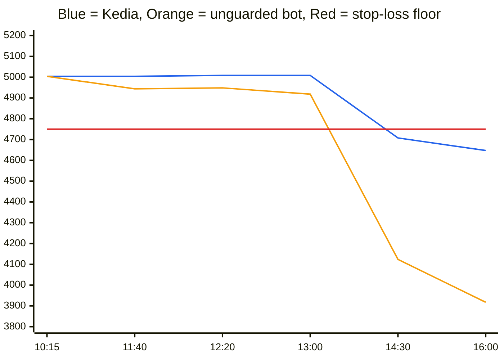
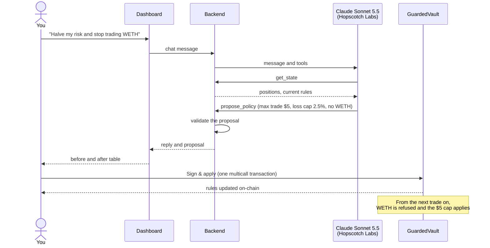

# Kedia

**An AI trading agent you can hand your money to, because it cannot break your rules.**

## Why we built it

AI agents can trade around the clock and react in seconds, but letting one trade means giving it a wallet key. A key can do anything, so one bug, hallucination or manipulated price can drain the account. Today's agents protect you with instructions in a prompt, and a prompt is only a request. We built Kedia so you can get an AI agent's speed without handing over control: your rules live in a smart contract, and code enforces them.

## When the agent trades

The agent looks for moments when **HSKSwap**, the DEX on **HSK Chain**, prices a token differently from the **HashKey Exchange** order book:

- **It buys** when HSKSwap sells a token more than 0.6% below the exchange price, after fees and price impact.
- **It sells** when HSKSwap pays more than 0.6% above the exchange price.
- **Otherwise it waits.** It checks every 30 seconds and trades at most once every 5 minutes, never larger than your max trade size.

Every trade goes through your vault, which checks it against your limits and refuses anything that breaks them.

## What you get

- **Earnings from price gaps** without watching the market. Each good trade earns roughly the size of the gap.
- **Your money stays yours.** Funds sit in a vault you own. The agent's key can ask for a swap but cannot withdraw.
- **Risk limits enforced by code.** Trade size, a daily stop-loss, allowed tokens, trade frequency and a price sanity check are checked on-chain for every trade.
- **Control in plain English.** Say "halve my risk" in chat, review the change, and sign it. Nothing changes without your signature.

Built for the HSK Chain Horizon Hackathon (Mumbai), Track 1: AI Agent Trading.

## The problem

Concretely, an AI agent holding your wallet key can be:

- **Wrong.** A bug or a bad model output can place a trade ten times too big.
- **Tricked.** A prompt injection or a manipulated, thin liquidity pool can push it into a terrible fill.
- **Stubborn.** It may keep trading while it loses, because "stop at 5% loss" in a prompt is only a suggestion.

Kedia answers each of these with a check the vault runs on every trade. A smart contract that reverts the transaction is a guarantee.

## What you get, and how

| You get | How |
|---|---|
| **Hands-off trading** | The agent watches HSKSwap against the HashKey Exchange price and trades when HSKSwap is mispriced. |
| **Custody stays with you** | Funds sit in your vault. The agent's key can only call one function, `executeSwap`, and cannot withdraw. |
| **Limits that cannot be bypassed** | Trade size, daily stop-loss, allowed tokens, trade frequency and a price sanity check are enforced on-chain. A breaking trade reverts. |
| **Control in plain English** | "Halve my risk and stop trading WETH" becomes a proposed rule change. You review the before and after, then sign one transaction. |
| **Full visibility** | The dashboard shows positions, P&L, today's stop-loss floor, the agent's reasoning, and every trade and rejection with an explorer link. |
| **Exit any time** | You can pause trading or withdraw instantly. Withdrawals never depend on the price oracle. |

## Example: one day with a $5,000 vault

You deposit **3,500 USDT and $1,500 of WHSK**, so your vault is worth **$5,000**. You set the max trade to **$500**; the default of $10 is for testing. HSKSwap's WHSK pool fills a $500 trade within about 0.2% of the exchange price, so that is a size the pool handles well. The daily loss cap stays at 5%, so when the agent's first trade of the day records $5,000 as the starting point, today's stop-loss floor is **$4,750**.

The table compares Kedia with a regular trading bot that holds your wallet key. The bot runs the same strategy, so both make the same good trades.

| Time | What happens | Kedia | Bot holding your key |
|---|---|---|---|
| 10:15 | HSKSwap sells WHSK 0.8% below the exchange price. The agent buys $500 of it. | Kept. **+$4.00**. Vault: $5,004 | Same. $5,004 |
| 11:40 | The agent sells $500 of WHSK. A front-running bot pushes the pool down 12% in the same block. | The fill is worth $440, more than 5% under the oracle value. `ExecutionPriceDeviates`: the swap is undone. Vault: $5,004 | Sells for $440. **−$60**. $4,944 |
| 12:20 | HSKSwap pays 0.9% above the exchange price. The agent sells $500 of WHSK. | Kept. **+$4.50**. Vault: $5,008.50 | Same. $4,948.50 |
| 13:00 | A bug in a strategy update sizes the next order at $3,000. | `TradeTooLarge`. Nothing moves. | Buys $3,000 of WHSK and pays about 1% in price impact. **−$30**. $4,918.50 |
| 14:30 | HSK falls 20% across the market. The vault is now worth $4,707.70, under the $4,750 floor. The agent tries to buy the dip. | `DailyLossCapBreached`. Every trade is refused while value is under the floor. | Spends its last $944.50 of USDT on the dip. $4,123.70 |
| 16:00 | HSK falls another 5%. | Only the WHSK already held moves. $4,647.54 | Holds only WHSK now. $3,917.52 |
| 18:00 | You type "halve my risk and stop trading WETH" and press **Sign & apply**. | One transaction: max trade $250, loss cap 2.5%, WETH blocked. The agent cannot undo it. | You edit a config file or prompt and hope the bot follows it. |
| 00:00 UTC | A new day starts. | The next trade records a new starting point. Tomorrow's floor is 2.5% below it, about $4,531. | — |



Values are in USD. The orange line drops at each event the vault blocked for Kedia.

**End of the day:**

| Strategy | Vault value at 18:00 | Change |
|---|---|---|
| Kedia | **$4,647.54** | −7.05% |
| Just holding, no trading | $4,640.00 | −7.20% |
| Bot holding your key | $3,917.52 | −21.65% |

On this bad day for HSK, Kedia **earned $8.50** from two good trades and **avoided $730 of losses** that the unguarded bot took on: a front-run fill, a buggy oversized order, and buying the dip with all its cash. The market drop itself hit everyone who held WHSK.

The stop-loss stops the *agent*. It does not sell what you already hold, so your WHSK still moves with the market. To get out completely, press **Pause** or withdraw; withdrawals never depend on the oracle.

### How much can it earn?

Earnings come from HSKSwap's price drifting away from the HashKey Exchange price. The agent trades only when the gap is over 0.6% after fees, so each good $500 trade earns roughly the gap: about **$4** at a typical 0.8% gap. Gaps of 0.6% to 1.2% showed up in testing.

| Day | Good trades | Earnings | On a $5,000 vault |
|---|---|---|---|
| Quiet | 1 | about $4 | 0.08% |
| Typical | 3 | about $12 | 0.24% |
| Busy | 6 | about $24 | 0.48% |

If typical days repeated every day, that would add up to about $360 a month. Treat that as an upper estimate, not a promise. Gaps shrink as other traders compete for them, and price moves in the tokens you hold usually matter more than trading earnings, as the example day shows. What the vault does guarantee is that no trade breaks your rules.

### Why these numbers grow with HSK Chain

Today's figures are small because today's pools are small. The limit is how much a pool can absorb, not the product.

On HSKSwap, a trade's price impact grows with its size divided by the pool's depth. Today the WHSK pool takes a $500 trade for about 0.2% of price impact. In a pool twice as deep, a $1,000 trade has the same impact, so each price gap is worth about twice as much. More trading activity on the chain also creates price gaps more often, which means more chances to trade.

Keeping the same 0.2% impact and three good trades a day at a 0.8% gap:

| WHSK pool depth | Trade size | Typical day | Typical month | Vault size it suits |
|---|---|---|---|---|
| Today | $500 | about $12 | about $360 | $5,000 |
| 5× today | $2,500 | about $60 | about $1,800 | $25,000 |
| 20× today | $10,000 | about $240 | about $7,200 | $100,000 |

Two things to read correctly in this table:

- **The percentage stays about the same,** roughly 0.24% a day. What grows with liquidity is the amount each trade can carry, so bigger vaults can earn the same rate and total earnings grow with the chain.
- **The growth is not guaranteed to be exactly proportional.** Deeper, busier markets also attract more traders who close price gaps, so gaps can get smaller or shorter-lived as the chain grows.

As HSK Chain and HSKSwap gain liquidity, Kedia can safely handle larger vaults. Its guardrails scale with you: you raise the max trade size in the same chat-and-sign flow, and every other limit still applies.

Each guardrail in the example is checked by a fork test against real HSKSwap pools: `test_revert_executionPriceDeviates_manipulatedPool`, `test_revert_tradeTooLarge`, `test_revert_dailyLossCap_thenResetsNextDay` and `test_ownerBatchesPolicyChangeWithMulticall`.

## How it works

### The pieces


There are three roles, and each can do only its own job:

| Role | Holds | Can | Cannot |
|---|---|---|---|
| **You (owner)** | Your wallet | Deposit, withdraw, pause, change rules, replace the agent | Nothing is off limits |
| **The agent (operator)** | Its own wallet per vault, holding only HSK for gas | Ask its own vault for a swap | Withdraw, change rules, trade a blocked token or another user's vault, exceed a limit |
| **The chat model** | No key at all | Read state, propose rule or strategy changes, ask the agent to try a trade you requested | Apply anything without your click or signature |

### Many users, one agent wallet each

Anyone can use the same dashboard. Connecting a wallet that has no vault shows **Create your vault**. One transaction, about 1 HSK in gas plus the HSK you give the agent (5 by default), asks `VaultFactory` to deploy a GuardedVault that this wallet owns. The factory records the wallet-to-vault mapping on-chain (`vaultOf(wallet)`), allows one vault per wallet, and keeps no control after creation.

Every vault gets its own agent wallet as its operator, and the same transaction sends it the HSK it pays gas with. Each user's trades are paid from their own agent's HSK, and vaults trade in parallel because each agent wallet has its own nonce. The backend derives every agent key from one secret (`AGENT_MASTER_KEY`) and the vault creator's address, so it stores no keys. The agent panel shows the agent wallet; the owner can top it up, or take the HSK back to their wallet at any time.

The owner also edits the agent's settings in the same panel or by chat: strategy, which tokens it trades, size per trade, edge, slippage, how often it checks prices and the minimum gap between its own trades. These are off-chain settings, so they need no signature, and the vault's on-chain rules still bound every trade.

An agent wallet can only call `executeSwap` on its own vault. Even if the master secret leaked, an attacker could take the gas HSK and make trades inside each owner's rules, but could never withdraw vault funds, and every owner can pause or replace the agent at any time.

Chat, strategy changes and requested trades ask the wallet to sign in once with a free signature ([Sign-In with Ethereum](https://eips.ethereum.org/EIPS/eip-4361)). The backend then acts only on the vault that wallet owns, looked up on-chain. Visitors without a wallet see a read-only demo vault.

### What happens on every trade

Every 30 seconds the agent reads three prices:
- the HashKey Exchange order book, used as the reference price
- the price HSKSwap would actually fill at, quoted for the planned trade size
- the oracle price the vault itself uses

The default **mean-reversion** strategy buys when HSKSwap sells more than 0.6% below the exchange price and sells when HSKSwap pays more than 0.6% above it. A **momentum** strategy, comparing a fast and a slow moving average, is also available.

Before sending, the agent simulates the trade, so a trade the vault would refuse is logged with its reason and costs no gas. When it does send, the vault runs these checks in order:


The last two checks run after the swap, so a revert undoes the whole trade. That is what makes them hard limits: a thin or manipulated pool cannot fill you far from the market, and no single trade can push you past your daily loss cap.

| Rule | Default | What it stops |
|---|---|---|
| Allowed tokens | USDT, WHSK, WETH | Trading anything you did not approve |
| Max trade size | $10 | A runaway or mistaken order |
| Cooldown | Off | Rapid-fire trading, if you turn it on. The agent already waits 5 minutes between its own trades, and trades you ask for in chat go straight through |
| Oracle freshness | 26 hours | Trading on a dead price feed |
| Price band | 5% | Bad fills from thin or manipulated pools |
| Daily loss cap | 5% of the day's starting equity | Losing more than you accepted in one day |

### Changing the rules by chat



The model only proposes. Rules change on-chain only when the owner wallet signs, because the agent's key cannot call `setPolicy`.

You can also ask for a trade, such as "swap 10 HSK for USDT". The agent sends it through the vault like any other trade, so the same rules apply. Asking for "buy $100 of WHSK" is refused on-chain with `TradeTooLarge`, which is the demo's main moment.

### Where prices come from

| Source | Used for |
|---|---|
| HashKey Exchange public order book (`HSKUSDT`, `ETHUSDT`) | The reference price the strategy compares against |
| HSKSwap QuoterV2 | The real price a trade of the planned size would get |
| Supra on-chain oracle, through `SupraFeedAdapter` | The price the vault trusts for size limits, the price band and the stop-loss |

APRO also publishes HSK, ETH and USDT feeds on HSK Chain. They only answer wallets and whitelisted contracts; any other contract gets `No access`, and a fork test proves it. The vault therefore reads Supra through a small adapter with the same interface. If APRO whitelists the vault, switching back is one owner call per token, `setAllowedToken(token, aproFeed)`. The APRO addresses are in `ABI/addresses.json` under `aproFeeds`.

## Demo

1. Connect a wallet and press **Create my vault**, then deposit USDT with the Deposit button. Without a wallet, the dashboard shows the demo vault read-only.
1. The dashboard shows positions, equity, P&L, today's stop-loss floor and the agent's live reasoning.
2. Let the agent trade. Each trade appears in the log with an explorer link.
3. In chat, say "halve my risk and stop trading WETH". Review the before and after table, then press **Sign & apply**. WETH shows as blocked.
4. Say "buy $100 of WHSK right now", or press **Try to trade 10× the limit**. The vault reverts on-chain with `TradeTooLarge`, and the explorer link shows the failed transaction.

## Project layout

```
SmartContracts/  Foundry: GuardedVault, VaultFactory, SupraFeedAdapter, mainnet-fork tests, deploy and fork scripts
ABI/             Shared config: addresses.json (chain 177) and the generated vault and factory ABIs (JSON + typed TS)
Backend/         Node 24 + viem: market data, strategies, agent loop, HTTP API
AI/              Chat: Claude Sonnet 5.5 via Hopscotch Labs, with tools get_state, propose_policy,
                 propose_strategy, attempt_trade
Frontend/        Next.js + wagmi: dashboard, trade log, chat, sign-to-apply, guardrail demo
```

## Getting started

Requirements: Foundry 1.8.6 (`foundryup --install 1.8.6`), Node 24, pnpm.

```bash
git submodule update --init --recursive
pnpm install
pnpm test        # 31 fork tests + backend, AI and frontend unit tests
```

### Test locally on a mainnet fork (fake money)

Terminal 1, from the repo root, starts a local copy of HSK mainnet:

```bash
anvil --fork-url https://mainnet.hsk.xyz --port 8547
```

Terminal 2, from the repo root, deploys the factory and funds the demo vault (30 USDT + 300 WHSK):

```bash
SmartContracts/fork-setup.sh
```

Still in terminal 2, start the backend against the fork with the fork-only agent master key that `fork-setup.sh` uses. These values override `Backend/.env` for this run only; chat still uses your Hopscotch key from `.env`.

```bash
RPC_URL=http://127.0.0.1:8547 AGENT_MASTER_KEY=0x15e88afcecd0892d8d4e40d498ec9d71f154643b0de7fc32d6fb573b7fd9340e pnpm backend
```

Terminal 3, from the repo root, starts the dashboard at http://localhost:3000:

```bash
NEXT_PUBLIC_RPC_URL=http://127.0.0.1:8547 pnpm frontend
```

The demo vault belongs to anvil account 0. To try the app as a new user, connect any other wallet account on the fork and press **Create my vault**. Fund it with fake USDT using the `anvil_setStorageAt` line in `SmartContracts/fork-setup.sh`. When done, stop all three and restore the mainnet config before deploying for real:

```bash
git checkout ABI/addresses.json
```

### Deploy to mainnet

You need your **owner** wallet and an **agent master key**:

- **Owner**: your wallet. It holds the funds you deposit (about $30 to $50 of USDT plus a little WHSK or WETH) and about 10 HSK: gas to deploy, plus the HSK the demo vault's agent trades with.
- **Agent master key**: a random 32-byte secret the backend derives every agent wallet from. Keep it secret and backed up; the same value goes in `Backend/.env`.

```bash
cast wallet import owner --interactive
cast keccak "$(openssl rand -hex 32)"         # your AGENT_MASTER_KEY
cd SmartContracts
AGENT_MASTER_KEY=<key> forge script script/Deploy.s.sol --rpc-url hsk --account owner --broadcast --verify
```

The script deploys three price adapters and `VaultFactory` with the default rules from the table above. It then creates the owner wallet's own vault, which visitors see as the demo vault, sends its agent wallet 5 HSK (set `AGENT_FUNDING` in wei to change it), and writes the addresses into `ABI/addresses.json`.

### Run

```bash
cp Backend/.env.example Backend/.env          # set AGENT_MASTER_KEY and HOPSCOTCH_API_KEY
cp Frontend/.env.example Frontend/.env.local
pnpm backend                                  # API on :8787 plus the trading loop
pnpm frontend                                 # dashboard on :3000
```

Connect your wallet in the dashboard and deposit funds with its Deposit button, not a plain transfer, so P&L counts the deposit. Other users connect their own wallets and create their own vaults.

To open it to other users, host the frontend (Vercel works) with `NEXT_PUBLIC_API_URL` set to the backend's URL. The backend runs a loop that never stops, so it needs an always-on server with a persistent disk for `Backend/data/`. Set `HOST=0.0.0.0` and `FRONTEND_ORIGIN` to the dashboard's URL. Run `SIMULATE_ONLY=1 pnpm backend` to watch decisions without sending transactions.

### Chat model

Chat runs Claude Sonnet 5.5 through the [Hopscotch Labs](https://docs.hopscotchlabs.ai/) gateway. Hopscotch serves this model only on its OpenAI-compatible `/v1/chat/completions` endpoint, so the AI module uses the `openai` client pointed at Hopscotch.

| Variable | Default | |
|---|---|---|
| `HOPSCOTCH_API_KEY` | none | Your `ub_live_...` key. Only chat needs it; the agent trades without it. |
| `HOPSCOTCH_MODEL` | `anthropic/claude-sonnet-5-5` | Hopscotch ids are `provider/model`. |
| `HOPSCOTCH_BASE_URL` | `https://api.hopscotchlabs.ai/v1` | A value without `/v1` is accepted; the code appends it. |

To check the backend can read your key and reach the model, run this from the repo root. It sends one tiny request:

```bash
pnpm check:ai
```

To list the Claude ids your key can call, load the key into your shell first. Without that step, `$HOPSCOTCH_API_KEY` is empty and the command prints nothing.

```bash
export $(grep '^HOPSCOTCH_API_KEY=' Backend/.env)
curl -s https://api.hopscotchlabs.ai/v1/models -H "Authorization: Bearer $HOPSCOTCH_API_KEY" | grep -o '"anthropic/claude[^"]*"'
```

Hopscotch refuses `reasoning_effort` for this model, so requests run at the model's default effort.

## Verified HSK Chain facts (2026-10-25)

| | |
|---|---|
| Chain | id 177, `https://mainnet.hsk.xyz`, explorer `https://hashkey.blockscout.com`, Cancun EVM, gas about 500 gwei |
| HSKSwap | SwapRouter02 `0x2c16…D8F3`, QuoterV2 `0x603f…bFDD`, factory `0x972c…c742` |
| Pools | WHSK/USDT 0.3% `0x4ff5…05dc`, WETH/USDT 0.3% `0xb92b…4c16` |
| Log queries | `eth_getLogs` is capped at 100,000 blocks; the backend scans in chunks |

## Known limits

- One vault per wallet, no upgradeability. Each user pays their own agent's gas; the platform charges nothing yet.
- All agent wallets come from one master secret on the backend, so the backend must be trusted with every agent's gas HSK (never with vault funds).
- Sign-in sessions live in the backend's memory, so a backend restart asks each user to sign in again.
- The stop-loss is marked at oracle prices, so a lagging feed can hold equity under the floor and block trading until the price recovers or the next UTC day starts. That is the guardrail working. The owner can also reset it by depositing, withdrawing or raising the cap.
- Supra's on-chain prices are refreshed by whoever pushes Supra proofs. The vault refuses to trade if a price is older than the freshness limit.
