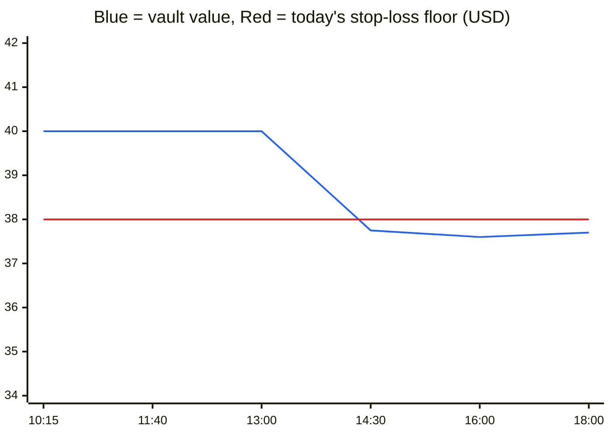
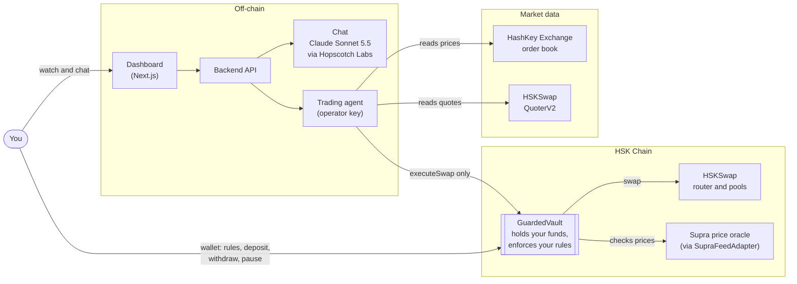
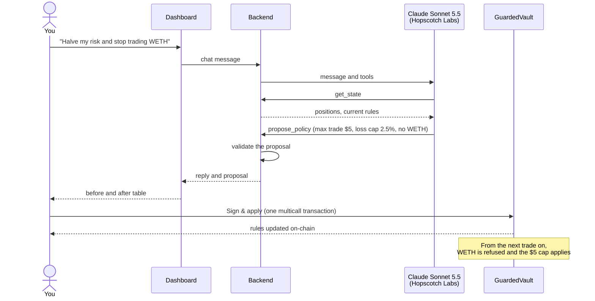

# Guarded Trader

**An AI trading agent you can hand your money to, because it cannot break your rules.**

Guarded Trader runs an AI agent that trades for you around the clock on **HSKSwap**, the DEX on **HSK Chain**. Your funds stay in a vault contract that you own. The agent can ask the vault to make a trade, but the vault checks every trade against your limits and refuses anything that breaks them. You change those limits by chatting in plain English, and nothing changes until you sign it with your wallet.

Built for the HSK Chain Horizon Hackathon (Mumbai), Track 1: AI Agent Trading.

## The problem

An AI agent can watch markets 24/7 and act in seconds, which no person can. To let it trade, though, you usually give it a wallet key, and a key can do anything. The agent can be:

- **Wrong.** A bug or a bad model output can place a trade ten times too big.
- **Tricked.** A prompt injection or a manipulated, thin liquidity pool can push it into a terrible fill.
- **Stubborn.** It may keep trading while it loses, because "stop at 5% loss" in a prompt is only a suggestion.

Most AI trading bots protect you with instructions in a prompt. A prompt is a request. A smart contract that reverts the transaction is a guarantee.

## What it gives you

| You get | How |
|---|---|
| **Hands-off trading** | The agent watches HSKSwap against the HashKey Exchange price and trades when HSKSwap is mispriced. |
| **Custody stays with you** | Funds sit in your vault. The agent's key can only call one function, `executeSwap`, and cannot withdraw. |
| **Limits that cannot be bypassed** | Trade size, daily stop-loss, allowed tokens, trade frequency and a price sanity check are enforced on-chain. A breaking trade reverts. |
| **Control in plain English** | "Halve my risk and stop trading WETH" becomes a proposed rule change. You review the before and after, then sign one transaction. |
| **Full visibility** | The dashboard shows positions, P&L, today's stop-loss floor, the agent's reasoning, and every trade and rejection with an explorer link. |
| **Exit any time** | You can pause trading or withdraw instantly. Withdrawals never depend on the price oracle. |

## Example: one day with a $40 vault

You deposit 30 USDT and 115 WHSK (about $10), so your vault is worth **$40**. You keep the default rules: $10 max trade, 5% daily loss cap, 5% price band. The agent's first trade of the day records $40 as the starting point, so today's stop-loss floor is **$38**.

| Time | What happens | What the vault does | A bot holding your key instead |
|---|---|---|---|
| 10:15 | HSKSwap sells WHSK 0.8% below the HashKey Exchange price. The agent buys $5 of WHSK. | Every check passes. Trade kept. | Same trade. |
| 11:40 | The agent sells $5 of WHSK. A bot front-runs it and pushes the pool price down 12% in the same block. | The fill is worth $4.40, more than 5% below the oracle value. `ExecutionPriceDeviates`: the swap is undone and you lose only gas, about 1 cent. | Sells at a 12% loss. |
| 13:00 | A bug in a strategy update sizes the next order at $100 instead of $5. | `TradeTooLarge`. Nothing moves. | Puts $100 of your funds into one trade. |
| 14:30 | HSK falls 15% across the market. Your $15 of WHSK drops to about $12.75, so the vault is worth $37.75, below the $38 floor. The agent sees a cheap pool and tries to buy the dip. | `DailyLossCapBreached`. While equity is under the floor, every trade is refused. | Keeps buying the dip with your remaining USDT, so the loss grows. |
| 18:00 | You type "halve my risk and stop trading WETH" and press **Sign & apply**. | One transaction: max trade $5, loss cap 2.5%, WETH blocked. The agent cannot undo it. | You edit a config file or prompt and hope the bot follows it. |
| 00:00 UTC | A new day starts. | The next trade records a new starting point, and the 2.5% cap applies from there. | — |



The blue line is the vault's value, and the red line is today's floor. Once value crosses below the floor, the agent cannot trade again until value recovers above it or the next day begins.

The stop-loss stops the *agent*. It does not sell what you already hold, so your WHSK still moves with the market. To get out completely, press **Pause** or withdraw; withdrawals never depend on the oracle.

Each row is behaviour the fork tests check against real HSKSwap pools: `test_revert_executionPriceDeviates_manipulatedPool`, `test_revert_tradeTooLarge`, `test_revert_dailyLossCap_thenResetsNextDay` and `test_ownerBatchesPolicyChangeWithMulticall`.

## How it works

### The pieces



There are three roles, and each can do only its own job:

| Role | Holds | Can | Cannot |
|---|---|---|---|
| **You (owner)** | Your wallet | Deposit, withdraw, pause, change rules, replace the agent | Nothing is off limits |
| **The agent (operator)** | A fresh key with gas money only | Ask the vault for a swap | Withdraw, change rules, trade a blocked token, exceed a limit |
| **The chat model** | No key at all | Read state, propose rule or strategy changes, ask the agent to try a trade you requested | Apply anything without your click or signature |

### What happens on every trade

Every 30 seconds the agent reads three prices:
- the HashKey Exchange order book, used as the reference price
- the price HSKSwap would actually fill at, quoted for the planned trade size
- the oracle price the vault itself uses

The default **mean-reversion** strategy buys when HSKSwap sells more than 0.6% below the exchange price and sells when HSKSwap pays more than 0.6% above it. A **momentum** strategy, comparing a fast and a slow moving average, is also available.

Before sending, the agent simulates the trade, so a trade the vault would refuse is logged with its reason and costs no gas. When it does send, the vault runs these checks in order:


The last two checks run after the swap, so a revert undoes the whole trade. That is what makes them hard limits: a thin or manipulated pool cannot fill you far from the market, and no single trade can push you past your daily loss cap.

| Rule | Default | What it stops |
|---|---|---|
| Allowed tokens | USDT, WHSK, WETH | Trading anything you did not approve |
| Max trade size | $10 | A runaway or mistaken order |
| Cooldown | 5 minutes | Rapid-fire trading and churn |
| Oracle freshness | 26 hours | Trading on a dead price feed |
| Price band | 5% | Bad fills from thin or manipulated pools |
| Daily loss cap | 5% of the day's starting equity | Losing more than you accepted in one day |

### Changing the rules by chat



The model only proposes. Rules change on-chain only when the owner wallet signs, because the agent's key cannot call `setPolicy`.

You can also ask for a trade, such as "swap 10 HSK for USDT". The agent sends it through the vault like any other trade, so the same rules apply. Asking for "buy $100 of WHSK" is refused on-chain with `TradeTooLarge`, which is the demo's main moment.

### Where prices come from

| Source | Used for |
|---|---|
| HashKey Exchange public order book (`HSKUSDT`, `ETHUSDT`) | The reference price the strategy compares against |
| HSKSwap QuoterV2 | The real price a trade of the planned size would get |
| Supra on-chain oracle, through `SupraFeedAdapter` | The price the vault trusts for size limits, the price band and the stop-loss |

APRO also publishes HSK, ETH and USDT feeds on HSK Chain. They only answer wallets and whitelisted contracts; any other contract gets `No access`, and a fork test proves it. The vault therefore reads Supra through a small adapter with the same interface. If APRO whitelists the vault, switching back is one owner call per token, `setAllowedToken(token, aproFeed)`. The APRO addresses are in `ABI/addresses.json` under `aproFeeds`.

## Demo

1. The dashboard shows positions, equity, P&L, today's stop-loss floor and the agent's live reasoning.
2. Let the agent trade. Each trade appears in the log with an explorer link.
3. In chat, say "halve my risk and stop trading WETH". Review the before and after table, then press **Sign & apply**. WETH shows as blocked.
4. Say "buy $100 of WHSK right now", or press **Try to trade 10× the limit**. The vault reverts on-chain with `TradeTooLarge`, and the explorer link shows the failed transaction.

## Project layout

```
SmartContracts/  Foundry: GuardedVault, SupraFeedAdapter, mainnet-fork tests, deploy and fork scripts
ABI/             Shared config: addresses.json (chain 177) and the generated vault ABI (JSON + typed TS)
Backend/         Node 24 + viem: market data, strategies, agent loop, HTTP API
AI/              Chat: Claude Sonnet 5.5 via Hopscotch Labs, with tools get_state, propose_policy,
                 propose_strategy, attempt_trade
Frontend/        Next.js + wagmi: dashboard, trade log, chat, sign-to-apply, guardrail demo
```

## Getting started

Requirements: Foundry 1.8.6 (`foundryup --install 1.8.6`), Node 24, pnpm.

```bash
git submodule update --init --recursive
pnpm install
pnpm test        # 21 fork tests + backend, AI and frontend unit tests
```

### Test locally on a mainnet fork (fake money)

Terminal 1, from the repo root, starts a local copy of HSK mainnet:

```bash
anvil --fork-url https://mainnet.hsk.xyz --port 8547
```

Terminal 2, from the repo root, deploys and funds a test vault (30 USDT + 300 WHSK):

```bash
SmartContracts/fork-setup.sh
```

Still in terminal 2, start the backend against the fork with anvil's test operator key. These values override `Backend/.env` for this run only; chat still uses your Hopscotch key from `.env`.

```bash
RPC_URL=http://127.0.0.1:8547 OPERATOR_PRIVATE_KEY=0x59c6995e998f97a5a0044966f0945389dc9e86dae88c7a8412f4603b6b78690d pnpm backend
```

Terminal 3, from the repo root, starts the dashboard at http://localhost:3000:

```bash
NEXT_PUBLIC_RPC_URL=http://127.0.0.1:8547 pnpm frontend
```

The fork owner is anvil account 0, so signing owner actions needs that test key imported in your wallet. Everything else works without a wallet. When done, stop all three and restore the mainnet config before deploying for real:

```bash
git checkout ABI/addresses.json
```

### Deploy to mainnet

You need two wallets:

- **Owner**: your wallet. It holds the funds you deposit (about $30 to $50 of USDT plus a little WHSK or WETH) and about 5 HSK for gas.
- **Operator**: a fresh key for the agent. It needs HSK for gas only, about 15 HSK for a week of active trading, and never holds funds.

```bash
cast wallet import owner --interactive
cd SmartContracts
OPERATOR=<operator address> forge script script/Deploy.s.sol --rpc-url hsk --account owner --broadcast --verify
```

The script deploys the vault and three price adapters, allows USDT, WHSK and WETH, sets the default rules from the table above, and writes the addresses into `ABI/addresses.json`.

### Run

```bash
cp Backend/.env.example Backend/.env          # set OPERATOR_PRIVATE_KEY and HOPSCOTCH_API_KEY
cp Frontend/.env.example Frontend/.env.local
pnpm backend                                  # API on :8787 plus the trading loop
pnpm frontend                                 # dashboard on :3000
```

Connect the owner wallet in the dashboard and deposit funds with its Deposit button, not a plain transfer, so P&L counts the deposit. Run `SIMULATE_ONLY=1 pnpm backend` to watch decisions without sending transactions.

### Chat model

Chat runs Claude Sonnet 5.5 through the [Hopscotch Labs](https://docs.hopscotchlabs.ai/) gateway. Hopscotch serves this model only on its OpenAI-compatible `/v1/chat/completions` endpoint, so the AI module uses the `openai` client pointed at Hopscotch.

| Variable | Default | |
|---|---|---|
| `HOPSCOTCH_API_KEY` | none | Your `ub_live_...` key. Only chat needs it; the agent trades without it. |
| `HOPSCOTCH_MODEL` | `anthropic/claude-sonnet-5-5` | Hopscotch ids are `provider/model`. |
| `HOPSCOTCH_BASE_URL` | `https://api.hopscotchlabs.ai/v1` | A value without `/v1` is accepted; the code appends it. |

To check the backend can read your key and reach the model, run this from the repo root. It sends one tiny request:

```bash
pnpm check:ai
```

To list the Claude ids your key can call, load the key into your shell first. Without that step, `$HOPSCOTCH_API_KEY` is empty and the command prints nothing.

```bash
export $(grep '^HOPSCOTCH_API_KEY=' Backend/.env)
curl -s https://api.hopscotchlabs.ai/v1/models -H "Authorization: Bearer $HOPSCOTCH_API_KEY" | grep -o '"anthropic/claude[^"]*"'
```

Hopscotch refuses `reasoning_effort` for this model, so requests run at the model's default effort.

## Verified HSK Chain facts (2026-10-25)

| | |
|---|---|
| Chain | id 177, `https://mainnet.hsk.xyz`, explorer `https://hashkey.blockscout.com`, Cancun EVM, gas about 500 gwei |
| HSKSwap | SwapRouter02 `0x2c16…D8F3`, QuoterV2 `0x603f…bFDD`, factory `0x972c…c742` |
| Pools | WHSK/USDT 0.3% `0x4ff5…05dc`, WETH/USDT 0.3% `0xb92b…4c16` |
| Log queries | `eth_getLogs` is capped at 100,000 blocks; the backend scans in chunks |

## Known limits

- Single owner, single vault, no upgradeability. The backend has no auth and listens on 127.0.0.1 only.
- The stop-loss is marked at oracle prices, so a lagging feed can hold equity under the floor and block trading until the price recovers or the next UTC day starts. That is the guardrail working. The owner can also reset it by depositing, withdrawing or raising the cap.
- Supra's on-chain prices are refreshed by whoever pushes Supra proofs. The vault refuses to trade if a price is older than the freshness limit.
